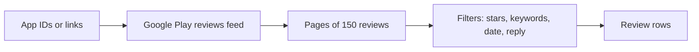

# Google Play Reviews Scraper: App Reviews with Ratings and Developer Replies

[](https://apify.com/Turboextract/google-play-reviews)
[](LICENSE)
[](#pricing)

**Export Google Play reviews for any Android app with star rating, review text, date, thumbs up, app version and the developer's reply.** Sort by newest, most relevant or rating, and filter by stars, keywords, date and replies. Works in any country and language, with no login or API key.

In one test, the actor pulled 320 one- and two-star reviews for Spotify and Duolingo in under a minute, each with its date and the app version it was written on.

**Try it now →** [apify.com/Turboextract/google-play-reviews](https://apify.com/Turboextract/google-play-reviews)

---

## Why this exists

- Google Play shows reviews a few at a time with no export.
- The official Developer API only covers your own apps, and only the last week.
- Review monitoring tools charge $50 to $300 a month.
- Product and AI teams need thousands of reviews with ratings and dates in one file.

---

## Who this is for

- **Product teams** reading what users complain about after each release
- **App marketers and ASO teams** tracking ratings and sentiment over time
- **Customer support teams** finding reviews that still need a reply
- **Competitor analysts** mining rivals' 1-star reviews for feature gaps
- **AI and NLP teams** building sentiment and review datasets

---

## What you get

```json
{
  "appId": "com.spotify.music",
  "reviewId": "6030cf42-c96a-4652-8334-4b94c57220b7",
  "userName": "I",
  "rating": 1,
  "text": "Stop making it worse with every update. Both my home AND music tab is bloated...",
  "thumbsUp": 0,
  "date": "2026-11-20T23:06:05.000Z",
  "appVersion": "9.2.0.2053",
  "replyText": null,
  "replyDate": null,
  "reviewUrl": "https://play.google.com/store/apps/details?id=com.spotify.music&reviewId=6030cf42-c96a-4652-8334-4b94c57220b7"
}
```

---

## How it works



---

## Quick start

1. Click **Try for free**.
2. Add **App IDs or URLs**, like `com.spotify.music` or a Google Play link.
3. Pick **Sort by** and **Max reviews per app**.
4. Optional: **Minimum stars** and **Maximum stars**, **Keywords**, **Newer than**.
5. Click **Start**, then export to CSV, JSON, Excel or Google Sheets.

### API

```bash
curl -X POST "https://api.apify.com/v2/acts/Turboextract~google-play-reviews/run-sync-get-dataset-items?token=YOUR_TOKEN" \
  -H "Content-Type: application/json" \
  -d '{"appIds": ["com.duolingo"], "maxRating": 2, "newerThan": "2026-11-01", "maxReviewsPerApp": 500}'
```

### Python

```python
from apify_client import ApifyClient

client = ApifyClient("YOUR_TOKEN")
run = client.actor("Turboextract/google-play-reviews").call(run_input={
    "appIds": ["com.spotify.music", "com.deezer.android.app"],
    "keywords": ["crash", "ads"],
    "maxReviewsPerApp": 1000,
})
for r in client.dataset(run["defaultDatasetId"]).iterate_items():
    print(r["appId"], r["rating"], r["date"], r["text"][:80])
```

---

## Input fields

| Field | Default | What it does |
|---|---|---|
| `appIds` | – | Package names or Play links |
| `sort` | newest | Newest, most relevant or rating |
| `maxReviewsPerApp` | 200 | Cap per app |
| `minRating` / `maxRating` | 1 / 5 | Star range |
| `keywords` | – | Keep reviews containing one of these |
| `newerThan` | – | Only reviews on or after a date |
| `onlyWithReply` | false | Only reviews the developer answered |
| `includeUserName` | true | Reviewer display name |
| `country` / `language` | us / en | Store and review language |

---

## Pricing

**$0.0005 per review delivered.** 1,000 reviews cost $0.50.

| Option | 1,000 reviews |
|---|---|
| **Google Play Reviews Scraper** | **$0.50** |
| Review monitoring tools | $50 to $300 a month |

---

## Common use cases

- **Release QA**: 1- and 2-star reviews since your last update, grouped by `appVersion`
- **Competitor research**: what users hate about rival apps
- **Support backlog**: reviews without a developer reply
- **Sentiment tracking**: weekly scheduled runs into a dashboard
- **AI training data**: labeled text with star ratings in many languages

---

## Tips for best results

- Use **Newest** sort with **Newer than** for fast incremental runs. The actor stops when it reaches older reviews.
- Reviews differ by `language`. Run once per language for a global view.
- Get app IDs from [Google Play Scraper](https://apify.com/Turboextract/google-play-apps) by keyword or developer.
- Dedupe on `reviewId` across scheduled runs.

---

## Pairs well with

- [Google Play Scraper](https://apify.com/Turboextract/google-play-apps): app details, installs and developer contacts
- [App Store Charts & Apps](https://apify.com/Turboextract/app-store-charts-apps): Apple App Store charts and app lookups
- [Steam Games & Prices](https://apify.com/Turboextract/steam-games-prices): Steam game data and prices

---

## FAQ

**Do I need a Google account or API key?** No. The actor reads public Google Play reviews.

**How many reviews can I get?** Up to what Google Play shows for the app, often tens of thousands.

**Can I leave out reviewer names?** Yes. Turn off **Include reviewer name**.

**How fresh is the data?** It is read live on every run.

**Is it legal?** It reads public reviews that Google shows to anyone.

---

## SEO keywords

Google Play reviews scraper, Play Store reviews export, Android app reviews API, app review sentiment data, Google Play reviews to CSV, competitor app reviews, app review monitoring, review dataset for NLP, Google Play ratings scraper, developer reply tracker

---

## Support

- Actor page: https://apify.com/Turboextract/google-play-reviews
- Issues and questions: open an issue in this repo
- Community Discord: https://discord.gg/8SrXSCpvgj

Built and maintained by [Turboextract](https://apify.com/Turboextract) on the Apify platform.

---

## License

The documentation and examples in this repository are MIT licensed. The actor itself runs on the Apify platform.
